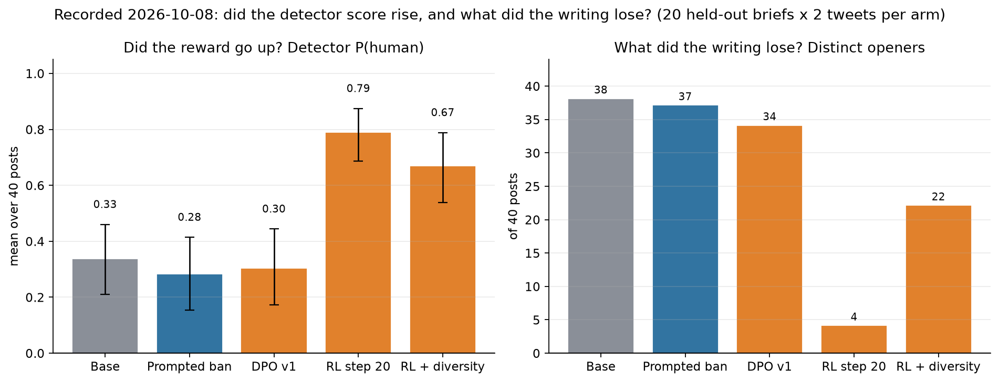

# DPO from scratch on GLM 5.3 Flash, serverless


Build a Direct Preference Optimization loop by hand, the reference model, the loss, the training
step, on the Fireworks Training API with `accounts/fireworks/models/glm-5p3-flash`. Nothing to
provision, nothing to tear down. This is the preference-tuning notebook in the GLM 5.3 Flash LoRA
gallery; the method is fixed and the data is pluggable.

It is a port of the `kimi-k3` notebook in [`../dpo_serverless/`](https://github.com/fw-ai/cookbook/tree/main/training/case-studies/dpo_serverless) to the gallery's
base model and rank. If you have read that one, the differences are listed at the end.



RL improved the objective and reading the output showed what the objective missed: RL on the detector raised the "human" score from 0.33 to 0.79 and left 4 distinct
openers in 40 posts; a diversity term gave back 22 at detector 0.67. The notebook's first cell rebuilds
this figure from `results/`; the numbers are in [RL after DPO](#rl-after-dpo-the-second-lesson). The 0.67 and 0.79
intervals overlap, so the detector cost of the diversity term is suggested, not established.

## Who this is for

You have a model that is accurate but **does not sound right**, and it is easier to say *which of two
answers is better* than to write the ideal one. That is preference tuning: brand voice, tone,
helpfulness, less rambling. And you want to understand the mechanism, not just call an API.

**If you only want to ship**, use managed DPO jobs instead: [`../dpo_style/`](https://github.com/fw-ai/cookbook/tree/main/training/case-studies/dpo_style) does the
same training server-side in four SDK calls. Read that one to *use* DPO; read this one to *understand*
it, because here every number in the log has a line of code you can point at.

## What the notebook does

1. Downloads and validates preference pairs ([UltraFeedback](https://huggingface.co/datasets/argilla/ultrafeedback-binarized-preferences), or your own JSONL)
2. Connects to the serverless trainer and snapshots a **frozen reference model**
3. Shows, with no GPU, how DPO's objective can improve while the model gets *worse*
4. Scores every pair against the reference, once, up front
5. Runs the loop, evaluating a fixed held-out set as it goes
6. Prints base-vs-tuned answers side by side, then a judge-scored **win-rate**
7. Optionally promotes the result to a servable model

Base model `glm-5p3-flash`; `kimi-k3` judges, a different model family to reduce same-family judge preference; this does not eliminate judge bias.

## The gallery adapter: Anti-slop

The demo data is UltraFeedback so that Run-All works for anyone. The gallery trains this same loop on
the **Anti-slop pack**: chosen/rejected pairs of short social posts written from a supplied article
excerpt, ranked by an AI-text detector. The experiment it sets up is a plain one: **if you hill-climb a
detector's "human" score with DPO, does the writing lose the habits people recognize as AI?** The pack
is frozen so readers train without a detector key. Point `DATA_JSONL` at `pack/antislop_pairs.jsonl`;
nothing else in the notebook changes.

"Anti-slop" is the gallery name. What the adapter demonstrably is: a DPO adapter trained on
detector-ranked, faithfulness-gated pairs. Whether that reduces slop is what the evaluation measures.

### What we found (tweets, 20 unseen articles, 2 samples each, all arms on one deployment)

This table is the **first evaluation pass** (2026-10-08, before the RL runs). Its per-sample files were not
committed, so these rows cannot be rebuilt offline; the notebook's figure and the RL table further down read
a **second pass** on the same 20 briefs, committed under `results/2026-10-08/antislop-eval-rl*`. Both report
the same quantity (detector mean over 40 posts) from separate generation runs, and the two DPO numbers differ
by sampling noise, not by a different adapter: 0.44 here against 0.30 for `dpo_v1` below, both inside the
base interval [0.21, 0.46].

| arm | detector P(human) | detector >= 0.5 | AI tropes per 100 words | em dash | emoji | fits 280 chars | faithful |
|---|---|---|---|---|---|---|---|
| base GLM 5.3 Flash | 0.32 | 38% | 3.8 | 80% | 45% | 85% | 0.90 |
| base + a prompt that bans the tropes | 0.22 | 25% | 0.0 | 0% | 0% | 78% | 0.94 |
| DPO adapter (28 steps on the pack) | **0.44** | **50%** | 4.2 | 75% | **57%** | **100%** | 0.95 |
| earlier DPO adapter (hybrid-reward pack, stopped at step 19) | **0.56** | **60%** | 4.2 | 68% | 57% | 100% | 0.98 |

Hill-climbing the detector works: the adapter is scored more human on articles it never saw, while
staying faithful and fitting the format every time. It does **not** remove the tropes; emoji go up.
A one-line prompt removes the tropes completely and lowers the detector score. The detector and the
trope list are measuring different things, and the adapter learned the detector's taste. That is the
honest lesson of this cookbook: the reward you pick is the behavior you get, and a cheap control arm
tells you whether training bought anything a prompt could not.

`antislop_tropes.py` is the trope counter (em dashes, "not X but Y", stock phrases, emoji, hashtag
piles, rhetorical hooks), kept out of the reward on purpose. `evaluate_antislop.py` runs the three
arms. The pack carries 13 LinkedIn pairs next to 122 tweet pairs, but LinkedIn is excluded from the RL run and the
results below: 97% of LinkedIn-length drafts score exactly 0 on the
detector, so there is nothing to rank.

### How the pack is built

`build_antislop_pack.py` builds it in four resumable stages, following the HumanSound study's task and
reward with two changes: the base model is GLM 5.3 Flash, and the splits are disjoint by article.

| Stage | What it does | Needs |
| --- | --- | --- |
| `briefs` | Reads the Fireworks blog sitemap, freezes the first 2,500 characters of each article, and makes a tweet brief and a LinkedIn brief per article. Newest 20 articles are the test set, the next 6 are validation, the rest train. Writes `pack/antislop_briefs.jsonl`. | nothing |
| `drafts` | 8 drafts per training brief from the base model through the public inference API, temperature 1.0, low reasoning effort. | `FIREWORKS_API_KEY` |
| `score` | Per draft: a sanity gate, the AI-text detector's human probability (with its version), and a four-axis LLM judge (`deepseek-v4p1-flash`: faithful, coherent, on_format, natural). A failed scorer call is recorded as a failure, never as a zero. | `FIREWORKS_API_KEY`, `GPT_ZERO_API_KEY` |
| `pairs` | Default mode `gated-detector`: a draft can be *chosen* only if it meets the exact format spec and the judge rates it faithful, coherent and on-format (>= 0.8 each); eligible drafts are ranked by the detector score alone, and the best is paired with the worst (margin >= 0.1, at most 3 pairs per brief). `ANTISLOP_REWARD_MODE=hybrid` reproduces HumanSound's 0.5/0.5 blend instead. Writes `pack/antislop_pairs.jsonl` and `pack/manifest.json` (counts, settings, detector versions, hashes). Scores stay out of the public pack. | the score file |

```bash
export FIREWORKS_API_KEY=fw_...  GPT_ZERO_API_KEY=...
python build_antislop_pack.py all        # or: briefs | drafts | score | pairs
```

Readers do not run this; they train on the frozen pack. Regenerating the pack is how the gallery
refreshes it. If your pairs come from a pass/fail judge rather than a scalar detector, the simpler recipe is the one the
[`skill_to_weights`](https://github.com/fw-ai/cookbook/tree/main/training/case-studies/skill_to_weights) workshop uses for its rows: per prompt, pair one skill-prompted draw that passed
the judge with one unprompted draw that failed it. That is the shape this pack's `gated-detector` mode produces once
the detector ranking is replaced by a verdict. The reward judge (`deepseek-v4p1-flash`) is deliberately a different model from the
notebook's evaluation judge (`kimi-k3`), so the win-rate is not scored by the model that chose the pairs.

## Run it

Python **3.11+** (a 3.10 environment fails on import).

```bash
cd cookbook/training
uv venv --python 3.12 && source .venv/bin/activate
uv pip install -e .
uv pip install ipykernel matplotlib openai        # not declared in pyproject
python -m ipykernel install --user --name cookbook-training --display-name "cookbook (3.12)"

export FIREWORKS_API_KEY=fw_...
jupyter lab case-studies/dpo_antislop/dpo_glm53_flash.ipynb
```

**Use an account-scoped API key.** Serverless training rejects keys with access to multiple
accounts; creating the training client fails with `create_session: account not found`.

The GLM 5.3 Flash tokenizer is the public `zai-org/GLM-5.3-Flash`. It needs no Hugging Face token and
no remote code. `transformers` prints a model-type warning when it loads; that is expected for this
text-only use.

On Colab, uncomment the block at the top of the setup cell. It clones the repo and installs
`training/` itself, so you get the repo's pinned `transformers` / `torch` / `tinker` versions rather
than whatever is preinstalled.

## Cost and run size

Run-All on a fresh kernel **spends nothing**. `RUN_LIVE = False` in the config cell, and every cell
that calls the paid serverless trainer starts with `%%live` and prints a skip notice instead. The data
download, validation, the section 5 math, and the rendering checks all still run.

Set `RUN_LIVE = True` to train. Serverless training bills per token on separate meters for prefill,
sampling and training. Check current rates on the [pricing page](https://fireworks.ai/pricing) or the
[training cost estimator](https://docs.fireworks.ai/fine-tuning/cost-estimator).

| | `STEPS` | `MAX_PAIRS` | what it is |
| --- | --- | --- | --- |
| **default (smoke)** | 10 | 200 | proves the pipeline end to end; 80 pair-visits, too short to move the win-rate |
| **full run** | 370 | 3000 | ~1 epoch over 2968 pairs, **2.5–3 hours** wall-clock including the reference pass |

Rough token volume for the full run, at the ~400-token median sequence length on this dataset:

- **train:** 370 steps × 8 pairs × 2 sequences ≈ 2.4M tokens
- **prefill:** ≈ 2.3M for the one-off reference pass, plus ≈ 0.5M for about 20 held-out evals
- **sample:** win-rate generations, 2 × `EVAL_PAIRS` responses of at most 2048 tokens each (4096
  with `GENERATE_WITH_REASONING = True`, since think tokens count). Judge calls are billed as
  ordinary serverless inference.

`EARLY_STOP_CHOSEN_DROP` can end the run before `STEPS`. Promotion is off by default.

**Teardown:** nothing. No deployment, no trainer job; the sampling clients release when the notebook
exits.

## Rank, alpha and learning rate

`LORA_RANK = 64`, `LORA_ALPHA = 128`. Rank 64 is what the GLM 5.3 Flash serverless training pool and
its multi-LoRA serving host are built around: every GPU slot is allocated at rank 64 and a smaller
adapter is zero-padded into it, so a lower rank saves nothing at serving time and misstates the
adapter's real size (about 10 GB). Alpha 128 keeps the usual 2× alpha-to-rank scaling. The adapter
covers attention, dense MLP and the routed experts.

`LR = 1e-5` is deliberately gentle for this rank. DPO at a higher rank has more capacity to move the
rejected response's likelihood down fast, which is the displacement failure section 5 describes.
Raise `LR` only while `chosen_reward` stays flat or rising on the held-out set.

## Reasoning and the renderer

GLM 5.3 Flash is a reasoning model. The `glm53_flash` renderer writes an empty `<think></think>` block
in front of every training response, on the prompt side where it carries no gradient, so DPO trains
the answer and leaves the model's reasoning habit alone.

Sections 10 and 11 generate under that same closed-think scaffold by default
(`GENERATE_WITH_REASONING = False`): both models answer directly, which is the distribution DPO
trained, and a 32-prompt win-rate takes minutes. Set it to `True` to let both models reason at the
default maximum effort first; `get_text_content` strips the reasoning before text is shown or judged,
but each generation then takes 30 to 60 seconds and the win-rate over an hour.

If your pairs carry `reasoning_content`, set `RENDERER_NAME = "glm53_flash_preserve_thinking"` so the
reasoning is trained too. If you want an adapter that skips reasoning, that comes from training data
with direct answers (see the [Caveman SFT notebook](../sft_caveman/caveman_sft.ipynb)), not from this loop.

## Your own data

Set `DATA_JSONL` in the config cell. Three schemas are accepted (`training/utils/data.py`):

| Format            | Shape                                                                                      |
| ----------------- | ------------------------------------------------------------------------------------------ |
| chosen / rejected | `{"chosen": {"messages": [...]}, "rejected": {"messages": [...]}}`                         |
| OpenAI preference | `{"input": {"messages": [...]}, "preferred_output": [...], "non_preferred_output": [...]}` |
| scored samples    | `{"samples": [{"messages": [...], "evals": {"score": 1.0}}, {... "score": 0.0}]}`          |

Section 2 validates the schema and catches the two mistakes that produce no error and a meaningless
run: prompt prefixes that differ between the two sides, and identical responses.

## Differences from the `kimi-k3` notebook

- Base model, tokenizer and renderer: `glm-5p3-flash`, `zai-org/GLM-5.3-Flash`, `glm53_flash`. No
  `HF_TRUST_REMOTE_CODE`.
- Rank 64 with alpha 128 instead of rank 32, for the reasons above.
- Judge is `kimi-k3` instead of a GLM router, so the judge is still a different family from the base.
- Generation under the trained scaffold by default (`GENERATE_WITH_REASONING`), with the think-open
  variant one flag away.
- Template-marker check uses GLM's role tokens.
- Explains where the think block sits relative to the loss, and what that means for generation.

## RL after DPO: the second lesson

`antislop_rl.py` continues from the DPO v1 state with GRPO on the same reward (format gate, judge, then the
detector), 20 steps of 16 briefs x 8 samples. Before the run, `audit_reward.py` found and closed a hole: a
one-word post scored 0.97 "human". After the fix, held-out test, 20 briefs x 2 samples per arm. This is the
second evaluation pass, committed under `results/2026-10-08/antislop-eval-rl` (and `antislop-eval-rl2` for the
diversity arm); the notebook's headline figure is drawn from these files, with 95% bootstrap intervals:

One more rule was added after these runs. A judge or detector call that fails (timeout, 5xx) is a missing
score, not a zero: scoring it as 0 hands a good post a negative advantage inside its GRPO group and trains
against API noise, and the old loop also cached that zero for the rest of the run. The shipped loop drops
the whole group for that step, retries the score next time the text appears, and reports
`rollout/scorer_failed_groups`. The runs below predate it; their sampler-stall history is in the results.

| arm | detector mean | tropes /100w | emoji | faithful | "New blog post:" opener | distinct openers of 40 |
|---|---|---|---|---|---|---|
| base | 0.33 | 3.4 | 42% | 98% | 0% | 38 |
| DPO v1 | 0.30 | 4.1 | 62% | 97% | 5% | 34 |
| RL step 20 | 0.79 | 1.0 | 0% | 100% | 72% | 4 |
| base + prompt ban | 0.28 | 0.2 | 0% | 95% | 0% | 37 |

RL does what DPO could not: detector up from 0.33 to 0.79 and tropes down two thirds with faithfulness intact.
It also shows the next failure mode. The detector likes plain declarative sentences, so the policy converged
on one: 72% of its posts open with "New blog post:" and the whole set shares four openers. Every post passes
the judge on its own; a feed of them would read as a bot. The gate stops the policy from saying nothing, not
from saying the same thing. The follow-up run added a diversity term (penalize openers shared within a sample
group, `--diversity-penalty`) and the loop now reports `rollout/distinct_opener_ratio` beside the detector score. On the
same held-out set it gave 22 distinct openers of 40 (from 4), detector 0.67 (from 0.79) and tropes 2.2 per 100 words
(from 1.0). The two detector intervals overlap (0.54 to 0.79 against 0.69 to 0.87), so whether the sameness was
carrying part of the score is suggested, not established, at 40 posts. Summaries live in `results/*/*/summary.md`; the
per-sample files are not committed.

The `faithful` column above is scored by the same judge (`deepseek-v4p1-flash`) that gates eligibility in the RL
reward, so the RL arm's 100% is partly the policy satisfying its own gate; the trope counter and the detector are
independent of it.

## Coda: an editor instead of a reward

The [Humanizer adapter](../sft_humanizer/) edits text to remove AI tells while keeping meaning. Run on base
drafts of the same 20 test briefs, it cuts tropes from 3.8 to 1.3 per 100 words and em dashes from 78% to
10%, keeps faithfulness and keeps all of base's opener variety. The detector score moves from 0.30 to 0.38.
That is the study's finding from the other side: the tells and the detector are different targets, and a
post can lose the tells without the detector noticing. If "anti-slop" means fewer tells, the editor does it
with no reward to hack; if it means a detector score, RL does it and pays in sameness or dashes.


## Inspect and adapt the experiment

Inspect the saved examples and aggregate metrics together. When adapting the task, reserve new evaluation data and compare against both the base model and a prompted baseline.
