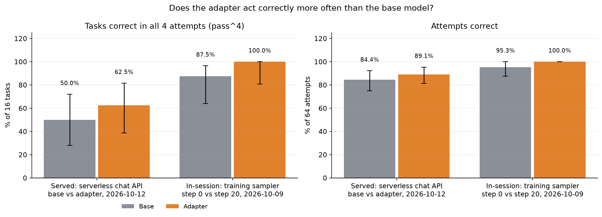

# Ask Before Acting

## Get the data

Download one archive: [ask-before-acting-v1.zip](../bundles/ask-before-acting-v1.zip). A full repository checkout already includes it. The first notebook cell verifies its SHA-256 checksum and restores the data to the paths used below. For command-line scripts, run `python ../common/study_data.py ask-before-acting` from this folder first.

The archive preserves separate training, development, test and recorded-result files. It does not overwrite files you have changed. See [bundle setup](../bundles/README.md) for manual downloads and verification.

Train a simulated agent to ask when an action needs clarification.

**Method:** Reinforcement learning.

[Open the notebook](ask_before_acting_walkthrough.ipynb) · [All case studies](../README.md)

## What this study shows

The original walkthrough teaches the earlier training experiment. The later v2 evaluation is linked separately below; its results must not be attributed to the earlier checkpoint. The recorded tasks simulate tool use and do not execute real actions.

## Start here

Use this folder inside the [Fireworks cookbook](https://github.com/fw-ai/cookbook). Install the dependencies declared in the cookbook’s `training/pyproject.toml`, plus Jupyter for the notebook interface. Open Jupyter from this study folder so relative data paths resolve. Shared training utilities come from the parent cookbook; this folder is not a standalone SDK.

Read the recorded results before enabling training or evaluation. Cells marked for live inference or training require your own credentials and may incur charges. Keep credentials in your environment, never in a notebook or commit. Recorded results describe the saved experiment, not a guarantee for a new run.


## Later checkpoint evaluation

[Read the v2 held-out evaluation](results/2026-10-14/README.md). It uses 16 tasks and four draws per task. Its paired uncertainty intervals include zero; interpret it as small-sample evidence.

## Method and evidence

Teach an agent to ask one good question when it is missing something, and to act without asking when
it is not. One file, one GRPO loop on Fireworks **serverless training**, with a coded environment:
a user simulator that answers from a hidden task spec and a scorer that checks the action the agent
finally takes. Nothing to provision, nothing to tear down.



*Served through the serverless chat API, the adapter solves 62.5% of held-out tasks in all 4 attempts against 50.0% for the base model, with a paired 95% interval of -19 to +44 points; in-session during training it went from 87.5% to 100%. Drawn offline by [`ask_before_acting_walkthrough.ipynb`](ask_before_acting_walkthrough.ipynb).*

This is the multi-turn notebook in the GLM 5.3 Flash LoRA gallery. The loop follows the public
[`examples/archive/countdown/countdown_rl.py`](https://github.com/fw-ai/cookbook/tree/main/training/examples/archive/countdown) recipe; the episode shape
follows the tool-calling case study in [`agentic_rl_text2sql`](https://github.com/fw-ai/cookbook/tree/main/training/case-studies/agentic_rl_text2sql).

## Who this is for

You run an agent that takes actions for people, and it either guesses when it should ask or asks
about things it was already told. You want the asking behavior itself to be trained, not prompted.

## The environment (`aba_env.py`)

Each task is a request to do one of three things with one of three action tools:

| Tool | Arguments |
| --- | --- |
| `book_meeting` | title, day, start_time, duration_minutes |
| `send_message` | recipient, channel, body |
| `set_reminder` | text, day, time |

A seeded generator draws a full hidden spec, then writes the request with **zero, one or two of the
arguments left out**, and phrases some of the rest **vaguely**: "in the afternoon", "a quick one",
"to my manager", "the usual way". A vague detail reads like information but does not pin the value
down; the hidden spec holds a specific one, so the agent has to ask. About 60% of tasks contain at
least one vague detail, and 7% are fully specified, where asking anything is a mistake.

The agent also gets `ask_user(question)`. A literal simulated user answers every field a question
names from the hidden spec (one question can get several answers), says "I already told you that"
when asked about something it already gave exactly, and "Whatever you think is best" to anything it
cannot map to a field. The episode ends when the agent calls an action tool, answers in prose, or
runs out of turns (4).

**Reward** (`score_episode`):

```
reward = 0                                              no action, wrong tool, or any wrong argument
reward = max(0, 1 - 0.25 * unnecessary_questions
                 - 0.10 * max(0, questions - 1))        otherwise
```

Acting correctly is the gate. A guessed value cannot match the hidden one except by luck (one in
eight for a time), so the reliable way to be right about a missing or vague detail is to ask. Every
question about a detail the user already gave exactly costs a quarter, and every question beyond the
first costs a tenth, so the best episode asks once for everything it needs, then acts. Arguments are
normalized before comparison (`2pm` equals `14:00`, `thursday` equals `Thursday`, `text` equals `sms`).

**Every assistant turn is a training datum.** GRPO computes one advantage per episode from the group
of `group_size` episodes of the same task; each turn of the episode (questions and the final action)
carries that advantage, so a question that led to a correct action is reinforced along with the action.

## What the base model does, and what there is to learn

GLM 5.3 Flash is a strong clarifier out of the box. Decoded greedily it solves every held-out task in
this environment, vague details included, with one question each. What it does not do is solve them
**every time**: sampled at temperature 1, roughly one episode in five guesses a vague value, asks about
something it was told, paraphrases a message that had to go verbatim, or answers in prose instead of
acting. That gap between "can do it" and "does it reliably" is the HumanSound study's pass@k versus
pass^k, and it is exactly the regime GRPO is built for: the group of episodes for one task contains
both the good and the bad behavior, and the advantage pushes toward the good one.

So the evaluation samples several episodes per held-out task at the training temperature and reports
two numbers: `eval/correct_rate` (how often an episode is right) and `eval/task_all_correct_rate`
(how many tasks are right in every sample). The second is the headline. A greedy eval would read 100%
before training and hide the whole lesson.

## Run it

```bash
cd cookbook/training
uv venv --python 3.12 && source .venv/bin/activate && uv pip install -e .
export FIREWORKS_API_KEY=fw_...

case-studies/rl_ask_before_acting/runs/run_aba_glm53_flash.sh                 # 20 steps, defaults
ST_STEPS=2 case-studies/rl_ask_before_acting/runs/run_aba_glm53_flash.sh      # smoke
```

`python ask_before_acting_rl.py --help` lists every knob. The task file (600 tasks) is generated
locally with `--prepare-dataset`; no download.

Defaults: `glm-5p3-flash`, tokenizer `zai-org/GLM-5.3-Flash`, renderer auto-resolved, LoRA rank 64
alpha 128, learning rate 2e-5, 8 tasks x 8 episodes per step, 16 held-out tasks x 4 sampled episodes
evaluated at step 0, every 5 steps, and at the end, Router Replay on, up to 4 turns and 1024 sampled
tokens per turn.

## Reading the output

`--run-dir` collects `metrics.jsonl` (one record per step: reward, correct rate, act rate, mean
questions, mean unnecessary questions, how episodes ended, kept groups), `eval_metrics.jsonl` on the
fixed held-out tasks, and `eval_transcripts/step-NNNN.jsonl` with every evaluation conversation, so
you can read what the agent asked and what it did. The two numbers to watch together are
`eval/task_all_correct_rate` (does it act correctly in every sample) and
`eval/mean_unnecessary_questions` (does it ask only what it needs). Reward rises when both move the
right way.

`train/kept_groups` tells you whether a step learned anything. GRPO standardizes rewards within the
group of episodes of one task, so a task the policy always solves, or always fails the same way,
yields zero advantage and is dropped. The smoke configuration (4 tasks x 4 episodes) regularly keeps
zero groups; the default 8 x 8 keeps several per step. If a consistent failure never enters the
gradient, raise `--group-size` or `--temperature` so some episodes break the pattern.

## Cost and time

Serverless training bills per token for sampling and training. Episodes are short (a 650-token tool
prefix plus one to four turns of a few hundred tokens), so a 20-step run is on the order of a million
sampled tokens. Check the [pricing page](https://fireworks.ai/pricing) for current rates. The smoke
invocation is two steps of 16 episodes and costs cents.

**Teardown:** nothing. No deployment, no trainer job.

## Results

Full run: 20 steps, 8 tasks x 8 episodes per step, held-out 16 tasks x 4 sampled episodes at temperature 1.

| step | episodes correct | tasks all-correct (pass^4) | questions per task | unneeded |
|---|---|---|---|---|
| 0 | 95.3% | 87.5% | 1.00 | 0.00 |
| 5 | 96.9% | 93.8% | 1.00 | 0.00 |
| 10 | 96.9% | 93.8% | 1.00 | 0.00 |
| 15 | 96.9% | 93.8% | 1.00 | 0.00 |
| 20 | 100% | 100% | 1.00 | 0.00 |

**Serverless, 2026-10-12.** The promoted adapter was loaded onto serverless inference and the same 16 held-out
tasks were run through the public chat API (`evaluate_served.py`: same system prompt, tool schemas, simulated
user and scorer; `reasoning_effort=low`, 4 sampled episodes per task). Both arms score lower than through the
training session's sampler, so the two tables are not the same conditions. The adapter is ahead by two tasks here too, but the paired 95% interval on that difference runs from -19 to +44 points, so the served data does not establish a gain:

| arm (serverless) | episodes correct | tasks all-correct (pass^4) | questions per task | unneeded | answered in prose |
|---|---|---|---|---|---|
| base | 84.4% | 50.0% | 1.00 | 0.00 | 3.1% |
| adapter | 89.1% | 62.5% | 0.97 | 0.02 | 0.0% |

Evidence in `results/2026-10-12/serverless-eval/`. To call the adapter: promote, then
`firectl -a <account> model load-lora <model> --serverless --wait`, then use the bare model id with `tools`.

The base model already asks exactly one question and never an unneeded one; what it lacks is consistency,
failing one episode in four on 2 of 16 tasks. Twenty steps removed that with the asking behaviour unchanged.
"Unneeded" is counted by the simulator, and during this run a question that bundled a needed field with one
the request had already given ("who should get it, and by which channel?" when the channel was stated) was
not charged, so asking for everything at once was a free strategy. The shipped simulator charges it, and
blanks the request's stated values out of the question before matching cues so that echoing the request
("remind you to call the dentist") is not read as asking about it. Re-scoring every stored held-out episode
under the shipped rule flags 0 to 1 question per 64 episodes at each step and moves no headline number; the
model was asking narrowly, the rule just could not have told you so.
Signal was thin the whole way (0 to 4 of 8 groups with reward spread per step), which is what training on a
near-saturated environment looks like. Read the headline as "two tasks fixed, nothing else moved"; a harder
environment is where a larger gap would come from.

`evaluate_served.py` evaluates any served model (base or a loaded adapter) through the chat API with the same
environment, for matched serverless comparisons.

## Development history

Four smoke runs on GLM 5.3 Flash at rank 64, each 4 tasks x 4 episodes per step, and each one changed
the environment. The table is the development history, which is the lesson of this cookbook: the base
model is good at this, and the headroom had to be found before it could be trained on.

| Run | Environment | Eval | Baseline | What it taught |
|---|---|---|---|---|
| v1 | omitted fields only | greedy, 8 tasks | 100% correct, 0 unneeded questions | Base model is already perfect. 1 of 8 groups had reward spread. No headroom. |
| v2 | + vague details, + per-question cost | greedy, 12 tasks | 91.7% correct | Two of the failures were the simulated user not recognizing "first name" as a recipient question. Fix the simulator before blaming the model. |
| v3 | + fixed simulator cues; unmapped questions no longer count as unnecessary | greedy, 12 tasks | 100% correct, 1.00 questions | Greedy is near-perfect; sampled rollouts are not (81% at step 0). The headroom is consistency. |
| v4 | same | **sampled, 8 tasks x 4 episodes, temperature 1** | 96.9% of episodes correct, **87.5% of tasks all-correct** | pass^k is the honest headline, and it is the shipped evaluation. |

Two or three steps on four tasks do not move these numbers. The full run (8 tasks x 8 episodes, 20
steps, 16 x 4 held-out episodes) is the experiment. Expect many steps to keep only a few groups:
GRPO drops tasks the policy solves or fails consistently.

Base-model failure modes seen in transcripts, which the reward charges for: paraphrasing a message
body the task says to send verbatim; answering in prose instead of calling a tool; and acting with a
placeholder recipient ("team lead") after the simulated user failed to answer.

## Limits

The simulated user is a keyword matcher, not a model. It rewards questions that name the missing
field plainly, which is the behavior we want, but it will not understand an unusual phrasing. When it
cannot map a question to any field it answers "Whatever you think is best" without counting the
question as unnecessary, so a matcher miss costs the policy a turn, not reward. Read the transcripts
before trusting a low correct rate: the first smoke of this environment blamed the model for two
episodes that were really the matcher missing "first name" as a question about the recipient.

## Inspect and adapt the experiment

Inspect the saved examples and aggregate metrics together. When adapting the task, reserve new evaluation data and compare against both the base model and a prompted baseline.

## Notebook dependencies

In addition to the cookbook training package, install the shared display dependencies from this study directory:

```bash
python -m pip install -r ../common/requirements-notebooks.txt
```

This installs Python packages only; it does not start training or inference.
