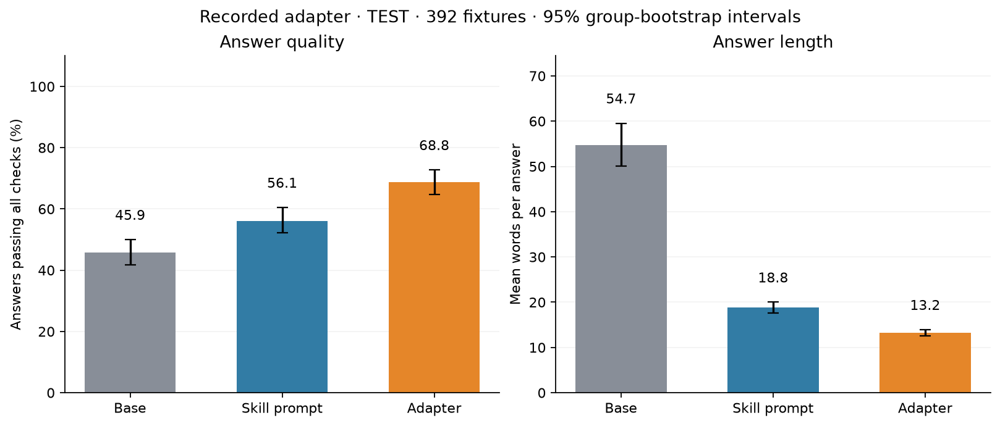

# Caveman

## Get the data

Download one archive: [caveman-v1.zip](../bundles/caveman-v1.zip). A full repository checkout already includes it. The first notebook cell verifies its SHA-256 checksum and restores the data to the paths used below. For command-line scripts, run `python ../common/study_data.py caveman` from this folder first.

The archive preserves separate training, development, test and recorded-result files. It does not overwrite files you have changed. See [bundle setup](../bundles/README.md) for manual downloads and verification.

Teach concise answers without dropping the facts.

**Method:** Supervised fine-tuning.

[Open the notebook](caveman_sft.ipynb) · [All case studies](../README.md)

## What this study shows

The frozen v2c release includes training, development and test examples, recorded comparisons, and a training plan. The selected run cost $4.68 for training only; data generation and evaluation are additional. The test set was reused during model selection.

## Start here

Use this folder inside the [Fireworks cookbook](https://github.com/fw-ai/cookbook). Install the dependencies declared in the cookbook’s `training/pyproject.toml`, plus Jupyter for the notebook interface. Open Jupyter from this study folder so relative data paths resolve. Shared training utilities come from the parent cookbook; this folder is not a standalone SDK.

Read the recorded results before enabling training or evaluation. Cells marked for live inference or training require your own credentials and may incur charges. Keep credentials in your environment, never in a notebook or commit. Recorded results describe the saved experiment, not a guarantee for a new run.


## Method and evidence



*Recorded v2c test: 392 fixtures × 8 draws per arm. Source: `release/v2c/recorded.json`. The test was reused by v2b and v2c; these are exploratory results.*

Turn a prompt into weights. The public [Caveman skill](https://github.com/JuliusBrussee/caveman) makes a
model answer tersely ("Bug in auth middleware. Token expiry check use `<` not `<=`. Fix:") while keeping
every technical fact. It works as a system prompt. This cookbook makes it the model's **default**, with no
prompt, by supervised fine-tuning a LoRA on answers the prompted model wrote itself. It is the SFT entry
in the GLM 5.3 Flash LoRA gallery and trains on Fireworks serverless training: nothing to provision.

## Current notebook

Start with [Caveman: teach a model to say more with fewer words](caveman_sft.ipynb).
It uses the frozen v2c bundle in `release/v2c/`: 2,348 teaching rows and a recorded 392-fixture evaluation.
Explore offline, explicitly enable training, then evaluate your own serverless adapter. Part 2 explains
how to change the data. The older results below are historical and are not the v2c recipe.

## Who this is for

You have a behavior you can already get with a long system prompt and you want it baked in: shorter
outputs, a house style, a response format. Self-distillation is the simplest way to do that, and the
interesting part is not the training loop (it is a few dozen lines) but **how you get clean targets
and how you check that the adapter kept the accuracy of the prompt**.

## How it works

```
author     a few hundred small fixtures: a question + 2-4 facts that fully determine the answer,
           plus the literals a correct answer must contain
verify     a second model solves each fixture from the facts alone; disagreements are dropped
teach      base model + skill prompt answers each TRAINING fixture twice (dev/test never see it)
filter     keep a target only if it passes mechanical and judged checks (below); shortest wins
train      SFT a rank-64 LoRA on {student prompt without the skill -> accepted target}
evaluate   base, base+skill prompt, and the adapter answer the held-out fixtures; same checks
```

The filter is the result of a human review of the first 28 teacher targets. The review's rules became
code: every required literal present; every number in the answer appears in the question, the facts or
the fixture's expected answer (so "80 / 10 = 8" passes and an invented figure fails); any negation word
satisfies a "not" requirement; at most 220 words; and a judge from a different model family scores
`supported`, `complete` and `on_request` at 0.8 or above. On the pack this accepted 64% of teacher samples, and 73%
of training fixtures ended up with at least one accepted sample.
Caveman grammar is never a defect; adding a procedure nobody asked for is.

## Files

| file | role |
|---|---|
| `build_caveman_pack.py` | `tasks \| targets \| filter \| pack \| all`. Writes `pack/caveman_{train,dev,test}.jsonl` and `pack/manifest.json`. Cached targets and scores are keyed by the input's content hash and the teacher/judge config, so rerunning `tasks` never attaches an old answer to a new fixture |
| `run_pack_sft.py` | one seeded SFT run on the pack, promotes the adapter. Trainer only, no in-session sampling |
| `evaluate_pack.py` | arms are chat-completions model names; `name=model:skill` appends the skill prompt; `--draws N` adds pass@k and pass^k |
| `calibrate_judge.py` | known-answer gate: one passing reply and one failing reply per judge axis; `evaluate_pack.py` runs it first and stops on a mismatch |
| `aggregate_seeds.py` | pass rate per arm with a paired bootstrap interval against base; agreement across seeds |
| `pack/` | the frozen pack: 164 train rows, 28 dev and 28 test fixtures. The split is a seeded shuffle of fixtures; fixture groups are singletons after de-duplication, so no group-level guarantee is implied |
| `sources/SKILL.md` | the pinned MIT skill, revision `2fd153c6`, used verbatim as the teacher prompt; `sources/SOURCE.md` has the upstream link |
| `review/` | the hash-bound human review of the pilot targets that the filter rules came from |
| `caveman_sft.ipynb`, `caveman_figures.py` | the notebook: sections 1-2 read the pack-scale results above and draw the figures; sections 3-8 walk the original 28-row pilot (see the notebook map below) |

### Notebook map

| Section | Purpose |
|---|---|
| See it | One real comparison, then quality and word-count evidence |
| Reproduce it | Inspect the frozen v2c pack, train explicitly, evaluate on serverless |
| Understand it | Relate targets to the skill and read a recorded failure |
| Change it | Improve development data and optionally build a new pack |

Run All is offline by default. Live stages require the cookbook training environment and explicit flags.

Fixtures are original and fictional, intended for Apache-2.0 release with the cookbook; the skill keeps
its MIT license. No reasoning text is stored.

## Results

Held-out test, 28 fixtures the teacher never saw, greedy decoding, `reasoning_effort=low`, the same
checks as the pack filter. "Pass" means literals and numbers clean **and** judge at 0.8+ on all three
axes.

| arm | pass | median words | Δ pass vs the base scored in the same run, 95% paired bootstrap |
|---|---|---|---|
| base, no prompt | 68-71% | 25 | |
| base + skill prompt (the teacher) | 75% | 11 | +4 [-14, +21] |
| adapter seed 29, no prompt | 82% | 10 | +11 [-4, +25] |
| adapter seed 17, no prompt | 82% | 15 | +11 [-4, +25] |
| adapter seed 43, no prompt | 86% | 8 | +18 [0, +36] |

Three seeds, mean pass 83%, mean gain over base +13 points, and the seeds agree on the pass/fail
verdict for 27 of 28 fixtures. The adapter reproduces the prompted teacher's brevity with no prompt and
does not lose accuracy. The gain over base is consistent in sign across seeds but the 28-fixture test
set cannot pin its size: two of three intervals include zero, so the honest claim is "no regression,
likely a small gain". Greedy decoding is not bit-reproducible across runs (the base scored 20, 20 and
19 of 28 in the three evaluation runs), so each adapter is paired with the base from its own run and
never with another run's; `aggregate_seeds.py` enforces that. Full tables are in
`results/2026-10-08/pack-eval-s*/` and `results/2026-10-08/three-seed-summary.md`.

Where the adapter still misses: the `cannot_tell` family (answering instead of saying the facts are
insufficient) and exact-format tasks with arithmetic in them. Two of its five misses were checker
strictness ("16 digits" about a 16-digit number).

**Serverless, 2026-10-12.** The seed-29 adapter was loaded onto serverless inference and the same 28 test
fixtures were evaluated with both arms through the public endpoint, no deployment, with the shipped checker:
base 71% pass at 26 median words, adapter 75% at 8 words (`results/2026-10-12/serverless-eval-s29/`).
The brevity transfer is the robust result; the pass-rate edge is within this test set's noise.

Training: 80 steps, batch 4, about two epochs, learning rate 1e-4, rank 64 / alpha 128, ten minutes. These results
were produced by the predecessor of the shipped scripts (a fixed 80-step runner and an evaluator without the
truncation check); the shipped `run_pack_sft.py --epochs 2` runs 82 steps. Every evaluation arm, base included, was
served by one dedicated multi-LoRA deployment, so serverless numbers may differ by a fixture or two.

One model does three jobs here: `deepseek-v4p1-flash` verifies the fixtures, filters the training targets, and
scores the held-out evaluation. The test fixtures are ones it agreed with and the targets are replies it rated 0.8
or above, so the ruler and the selector are the same model. The literal and number checks are independent of it.
After the pack was built the mechanical checker was tightened (numbers compared as whole tokens; a negation must
open the answer or sit within three words of another required literal, and an answer opening with "yes" fails
it); 5 of the 164 train rows came from samples it would now reject, and the pack is unchanged until the next
rebuild. A literal check cannot prove polarity in general; the judge's `complete` axis owns the rest. To call the adapter
yourself: promote, then `firectl -a <account> model load-lora <model> --serverless --wait`, then use the bare model id.

## Run it

```bash
export FIREWORKS_API_KEY=...
python build_caveman_pack.py all                                  # or skip: the pack is committed
python run_pack_sft.py --seed 29 --epochs 2 --output-model-id caveman-s29    # ~10 min
python evaluate_pack.py \
  --arm base=accounts/fireworks/models/glm-5p3-flash \
  --arm skill=accounts/fireworks/models/glm-5p3-flash:skill \
  --arm adapter=accounts/<your-account>/models/caveman-s29-<suffix>
python aggregate_seeds.py results/<date>/pack-eval
```

Rebuilding the pack costs a few dollars of inference and judge calls; training a seed is about a
dollar of serverless training tokens. The tutorial run above is the full run for this cookbook: the
pack is small enough that two epochs is the whole experiment.

## What this does and does not show

It shows that a prompt-induced style transfers into a rank-64 adapter on a small, filtered,
self-generated dataset without losing the prompt's accuracy on held-out tasks of the same shape. It
does not show transfer to tasks unlike the fixtures, lower hidden reasoning, or anything about the
upstream skill beyond the revision pinned here. Serving the adapter goes through the standard
multi-LoRA path; serverless adapter inference is a separate validation step.


## Inspect and adapt the experiment

Inspect the saved examples and aggregate metrics together. When adapting the task, reserve new evaluation data and compare against both the base model and a prompted baseline.
