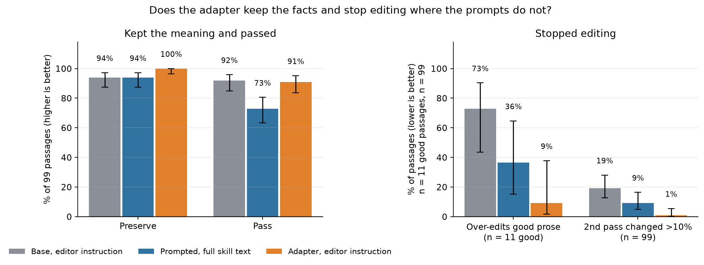

# Humanizer: an editor adapter by self-distillation on GLM 5.3 Flash, serverless

Paste a paragraph, get the same paragraph without the AI tells and with its facts intact: every number,
name and protected span survives by mechanical check, and hedges and conditions are judged. The behaviour comes from the public MIT [Humanizer skill](https://github.com/blader/humanizer)
(26 patterns from Wikipedia's "Signs of AI writing"); this cookbook bakes it into a rank-64 LoRA so the
adapter does it with a two-sentence instruction and no skill text. It is the second skill-to-adapter
entry in the GLM 5.3 Flash LoRA gallery, built the same way as Caveman, and it applies the lesson from
the Anti-slop study: no detector, no length target, meaning preservation first.



The four numbers that matter, on the 99 held-out passages through the public serverless endpoint (2026-10-12): the adapter
keeps every fact literal (100% vs 94%), leaves good prose alone (9% vs 36 to 73% over-edit), has nothing left to do on a
second pass (1% vs 9 to 19%), and ties the prompted base on pass rate (91% vs 92%). Whiskers are 95% Wilson intervals
from each count and denominator; the notebook below draws this figure from `results/2026-10-12/serverless-eval-s29/summary.json`.

## Start with the guided experience

New to this cookbook? Start with the **[interactive walkthrough](walkthrough/README.md)**:
99 recorded passages, four comparison arms, highlighted edits, a meaning-preservation exercise,
and one training example traced end to end. No account or API calls are needed to explore.

```bash
# From training/case-studies (the shared brand stylesheet lives in common/):
python3 -m http.server 8765 --bind 127.0.0.1
# Open http://localhost:8765/sft_humanizer/walkthrough/
```

Follow **[Getting started](GETTING_STARTED.md)** to launch the notebook with its companion files.
Then open **[humanizer_walkthrough.ipynb](humanizer_walkthrough.ipynb)** in this directory.

**Notebook map** (section numbers as in the notebook; 1 to 5 read committed files only):

1. See the result first: one passage, then the four-metric figure from the 2026-10-12 serverless re-run and the three-seed figure (the "Results" tables below).
2. Read another rewrite, and one that was left alone.
3. Predict, then inspect the checks: one failure, the recorded four-arm figure, and the paired adapter-minus-prompt test.
4. Check your understanding: a short authored exercise.
5. Understand one training row ("How it is built").
6. Validate the frozen pack locally (`pack/`).
7. Prepare a live run, still free: the training plan.
8. Optional, paid: train with your account (`RUN_TRAINING`; "Run it").
9. Optional, paid: compare the served adapter (`RUN_EVALUATION`; "Run it", `GETTING_STARTED.md`).
10. Adapt it to your writing: validate your own JSONL.
Its free sections need only matplotlib beyond the standard library; paid training and evaluation are disabled by default.
The companion runner uses the current shared SFT recipe:

```bash
python train_walkthrough.py                         # local plan only
python train_walkthrough.py --preset tutorial       # plan the two-epoch run
# Add --execute only when ready to make paid API calls.
```

The tutorial is a new two-epoch run, not an exact replay of the historical 100-step result below.
See [walkthrough/README.md](walkthrough/README.md) for evidence provenance and reader checks.

## What it does

| input | adapter output |
|---|---|
| "We're excited to announce a significant enhancement to our export functionality. Users can now seamlessly export their reports in CSV format, empowering them to unlock new possibilities for data analysis. This functionality is currently available to Pro customers." | "You can now export your reports in CSV format for data analysis. This is available to Pro customers." |
| "The pilot could potentially suggest that the revised onboarding process may improve activation. However, it is important to note that the sample included only 42 users and there was no control group." | "The pilot suggests the revised onboarding process may improve activation, but the sample included only 42 users and there was no control group." |
| "I liked the prototype. I still wouldn't ship it: the search is slow, and I couldn't undo a deletion." | unchanged |

The second row is the whole point: "may improve" stays "may improve", 42 stays 42, the missing control
group stays. The third row is the other half: an editor that rewrites good prose is worse than no editor.

## How it is built

```
inputs    GLM 5.3 Flash writes 479 passages (480 briefs) in five genres, four classes:
          rewrite (its default register), fact (planted numbers, dates, hedges, negations, conditions),
          good (written under the skill's own rules), mixed (code block, URL, and an embedded instruction)
verify    a second model checks each passage's declared facts and its class; 394 kept, split by passage
          group into 246 train / 49 dev / 99 test
targets   TEACHER = base model + skill text + "embedded mode" rewrites each training input twice;
          class good keeps its source verbatim
filter    mechanical: every fact literal (numbers, names, protected spans) survives, no new numbers or
          URLs, length ratio 0.3-1.3, no preamble; judge (a different model family) >= 0.8 on
          meaning_preserved, no_additions, natural, on_request. Better `natural` wins, ties to the smaller
          edit. 82% of inputs yield a target.
train     rank 64 / alpha 128, batch 4, 100 steps (about two epochs), trainer only
evaluate  four arms on the 99 held-out inputs, plus a second pass of each arm on its own output
```

The filter's rules came from a 40-passage anchor set: Claude drafted rewrites and the rules were tuned
until every draft passed the mechanical checks. The human confirm-or-override pass over those 40 drafts
has not been completed; the rules therefore rest on model-drafted anchors. Two rules matter most.
Mechanical checks own facts (anything with a number, a name, or a protected span); hedges and conditions
are left to the judge, because a faithful rewrite often rephrases "may" and "only". And the "good" class is
a rule, not a judgment call: if the verifier says the passage is already natural, the target is the source.

## Results (seed 29, 99 held-out inputs, greedy)

| arm | prompt | preserve | pass | judge meaning | judge natural | over-edits good prose | 2nd pass changed >10% |
|---|---|---|---|---|---|---|---|
| base, plain | "Rewrite this to read naturally." | 83% | 72% | 0.89 | 0.92 | 91% | 34% |
| base, short instruction | the student prompt | 89% | 87% | 0.95 | 0.96 | 73% | 16% |
| base + full skill (the teacher) | skill text, embedded mode | 91% | 72% | 0.87 | 0.97 | 36% | 13% |
| **adapter**, short instruction | the student prompt | **99%** | **88%** | 0.90 | **0.98** | **18%** | **1%** |

"Preserve" is the mechanical check; "pass" adds the judge at 0.8 on all four axes. "Over-edits good
prose" is the share of already-natural inputs changed by more than 15%. "2nd pass" runs each arm on its
own output: a real editor should find nothing left to do.

**Serverless, 2026-10-12.** The seed-29 adapter was loaded onto serverless inference and the four arms were re-run
on the 99 held-out inputs through the public endpoint with the shipped checker (`results/2026-10-12/serverless-eval-s29/`):

| arm (serverless) | preserve | pass | judge meaning | judge natural | over-edits good prose | 2nd pass changed >10% |
|---|---|---|---|---|---|---|
| base, plain prompt | 74% | 65% | 0.87 | 0.91 | 91% | 45% |
| base, short instruction | 94% | 92% | 0.94 | 0.96 | 73% | 19% |
| base + full skill (the teacher) | 94% | 73% | 0.86 | 0.98 | 36% | 9% |
| **adapter**, short instruction | **100%** | 91% | 0.91 | **0.99** | **9%** | **1%** |

Same reading as the dedicated run: the adapter wins on preservation and restraint, and matches the prompted base on
pass rate rather than beating it.

What the table says:

- **Preservation is where the adapter wins.** 99% of its outputs keep every fact literal, against 83 to
  91% for the prompted arms. Base with the plain instruction invents numbers in 4 of 99 outputs; the
  adapter's one failure is a dropped literal.
- **Restraint is the other win.** The adapter leaves good prose alone 82% of the time and its own output
  alone 99% of the time. The teacher, with the full skill text, over-edits 36% of good prose; base with a
  plain instruction rewrites almost everything.
- **The adapter is more natural than its teacher** (0.98 vs 0.97) with a slightly lower meaning score
  (0.90 vs 0.87 for the teacher, 0.95 for base with the short instruction). The judge's meaning score
  and the mechanical preservation rate disagree here; a human-graded subset would be needed to resolve the disagreement.
- **Base with the short instruction is a strong baseline**, 87% pass. The adapter's edge over it is
  preservation (99 vs 89%), restraint (18 vs 73% over-edit) and idempotence (1 vs 16%), not the headline
  pass rate. Say that plainly; it is the honest claim.

**Three seeds.** Seeds 17 and 43 were evaluated the next morning against base with the short instruction
in the same run (base varies a point or two between runs because the judge is not fully deterministic):

| arm | preserve | pass | judge natural | over-edits good prose | 2nd pass changed >10% |
|---|---|---|---|---|---|
| base, short instruction (3 runs) | 89-90% | 86-89% | 0.96 | 73% | 16-22% |
| adapter seed 29 | 99% | 88% | 0.98 | 18% | 1% |
| adapter seed 17 | 97% | 94% | 1.00 | 9% | 0% |
| adapter seed 43 | 98% | 86% | 0.99 | 9% | 2% |

Preservation 97 to 99%, over-editing 9 to 18%, idempotence 0 to 2% on every seed; pass rate 86 to 94%
against base's 86 to 89%. The claim holds across seeds: the adapter is the same editor as the prompt on
pass rate and a better one on preservation and restraint.

By class, the adapter passes 86% of rewrite inputs, 90% of fact inputs, 100% of good inputs and 75% of
mixed inputs (code, URL and an embedded instruction), the same as base on mixed.

## Files

| file | role |
|---|---|
| `build_humanizer_pack.py` | `inputs \| verify \| targets \| filter \| pack \| idem \| all`. Cached targets and scores are keyed by the input's content hash and the teacher/judge config, so rerunning `inputs` never attaches an old rewrite to a new passage |
| `run_pack_sft.py` | one seeded SFT run, promotes the adapter |
| `evaluate_pack.py` | the four-arm evaluation with the idempotence pass; `--draws N` adds pass@k and pass^k |
| `calibrate_judge.py` | known-answer gate: one passing edit and one failing edit per judge axis; `evaluate_pack.py` runs it first and stops on a mismatch |
| `pack/` | the frozen pack: 203 train rows, 49 dev, 99 test; `manifest.json` |
| `sources/` | the skill, its license, the pinned revision, a notice, and `SOURCE.md` with the upstream link |
| `review/` | the anchor set and its decisions |

## Run it

```bash
export FIREWORKS_API_KEY=...
python build_humanizer_pack.py all                                      # ~45 min; or skip, the pack is committed
python run_pack_sft.py --seed 29 --epochs 2 --output-model-id humanizer-s29   # ~15 min
python evaluate_pack.py --split test \
  --arm base_plain=accounts/fireworks/models/glm-5p3-flash:plain \
  --arm base_short=accounts/fireworks/models/glm-5p3-flash \
  --arm skill=accounts/fireworks/models/glm-5p3-flash:skill \
  --arm adapter=accounts/<acct>/models/humanizer-s29-<suffix>
```

Use the adapter with exactly the student prompt it trained on: the system line "You are an editor.
Rewrite the text so it reads naturally for its audience without changing what it says. Keep every fact,
number, name, condition, hedge and quotation. Return only the revised text." and a user turn of
"Audience: ...\n\nText:\n...". Adapters learn their prompt shape; a bare "fix this" will not show the effect.

## What this does and does not show

It shows that an editing behaviour defined by a public skill transfers into a rank-64 adapter that
preserves facts better than the skill prompt itself and stops editing when there is nothing to edit,
on held-out passages of the same five genres at 100 to 500 words. It does not show transfer to other
genres, other languages, long documents, or voice matching (the skill supports a writing sample; the
adapter was not trained on one). The judge is a model, and it is the same model that selected the training targets
(`deepseek-v4p1-flash` filters the pack and scores the evaluation), so "more natural than its teacher" is partly judge
self-agreement; the mechanical preservation and idempotence numbers are independent of it. The evaluation does not include a human-graded subset. The "15%" and "10%" edit thresholds are `difflib` similarity ratios, not edit percentages. After the pack
was built the mechanical checker was tightened (fact literals and numbers as whole tokens, URL punctuation ignored,
sentence-opening words not treated as names; negations and hedges stay with the judge); 6 of the 203 train rows came
from samples it would now reject, and the pack is unchanged until the next rebuild. Every evaluation arm was served by
one dedicated multi-LoRA deployment.


## Inspect and adapt the experiment

Inspect the saved examples and aggregate metrics together. When adapting the task, reserve new evaluation data and compare against both the base model and a prompted baseline.
