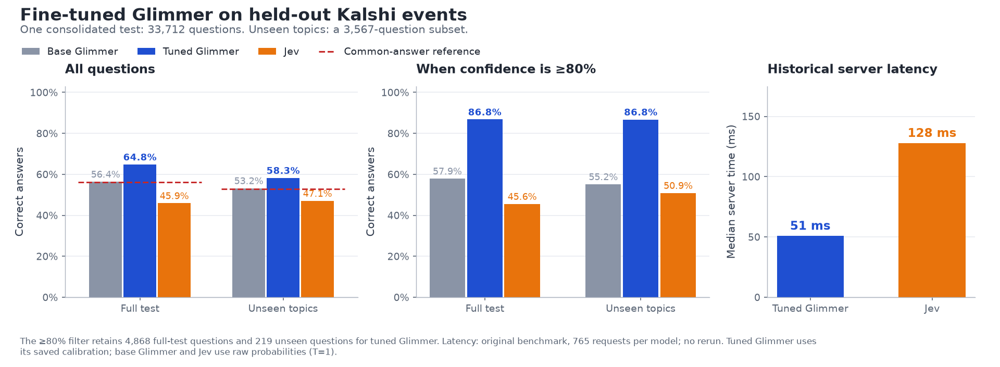
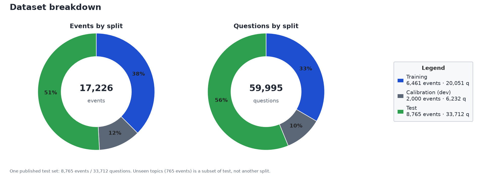
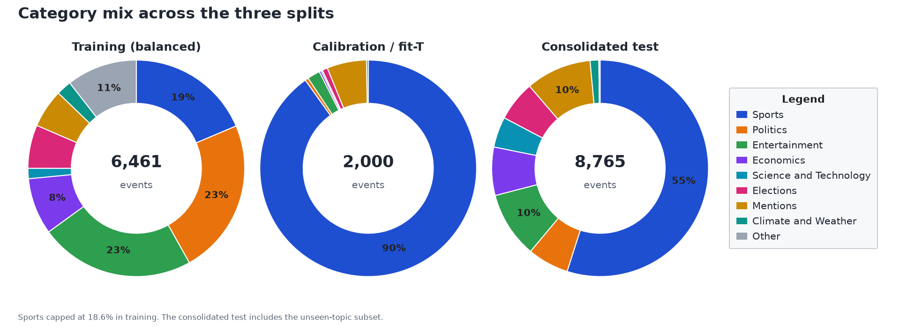
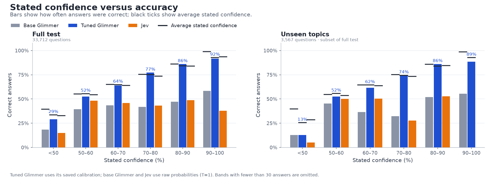
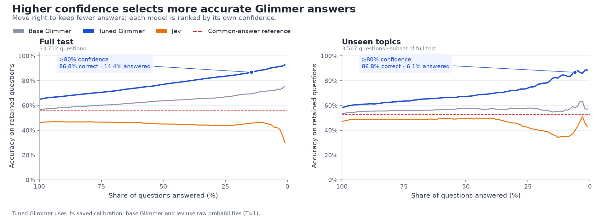
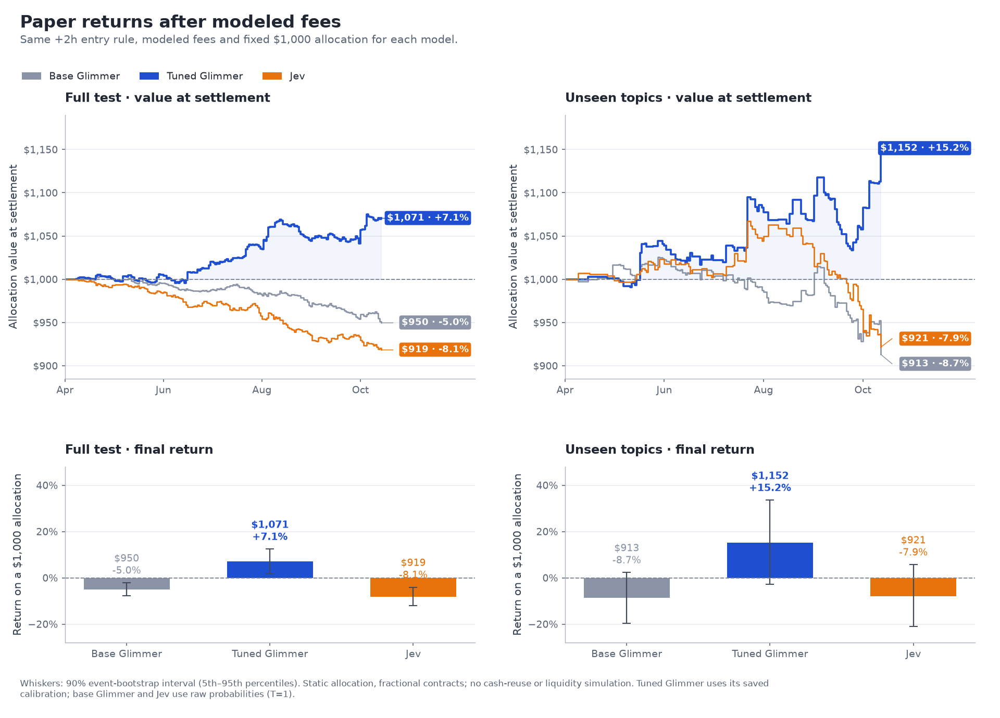
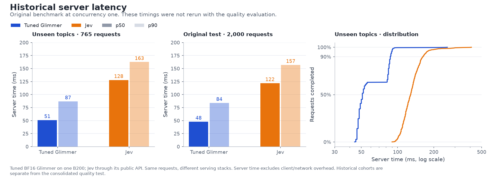

# Kalshi decision-tuning v1

Train Muse Glimmer 30B to assign probabilities to Kalshi outcomes with the
Fireworks Training API and K-way cross-entropy.

- On the **full test set**, tuned Glimmer answers **64.8%** correctly, versus
  **56.4%** for base Glimmer, **45.9%** for Jev and a **56.3%** common-answer reference.
- On the **unseen-topic subset**, it answers **58.3%** correctly, versus
  **53.2%** for base Glimmer, **47.1%** for Jev and the **52.9%** reference.
- A historical paper allocation turns $1,000 into **$1,071 (+7.1%)** on the full
  test set. This is a static backtest with fractional contracts and modeled fees.

**Only tuned Glimmer is calibrated. Base Glimmer and Jev use raw probabilities
(`T=1`).** Results were recomputed from saved model readouts.



## One test set

| Split | Public Fireworks resource | Events | Questions |
|---|---|---:|---:|
| Training | `accounts/fireworks/datasets/kalshi-decision-v1-train` | 6,461 | 20,051 |
| Calibration (dev) | `accounts/fireworks/datasets/kalshi-decision-v1-dev` | 2,000 | 6,232 |
| **Test** | `accounts/fireworks/datasets/kalshi-decision-v1-test` | **8,765** | **33,712** |

The test file consolidates the original 2,000-event evaluation, the later
6,000-event expansion and 765 unseen-topic events. We evaluate each event once.
**Unseen topics is a slice of this test set**, with 3,567 questions from 113
families excluded from training and calibration. It is also available separately
as `accounts/fireworks/datasets/kalshi-decision-v1-unseen-family` for convenience;
do not append that download to the test file.

`prepare_data.py` downloads the datasets from Fireworks through the SDK and
checks their SHA-256 hashes and row counts against the pins in `SPLITS`.

- Training events settled **before January 4, 2026**; Sports is capped at 18.6%.
- Calibration events opened **January 11, 2026 or later** and settled **before
  April 1, 2026**. Only this split fits tuned Glimmer's temperatures.
- Test events opened **April 8, 2026 or later**, after Glimmer's stated
  January 4 knowledge cutoff. Seven-day gaps separate the split windows.
- One event becomes one row with `state` and `questions`. Mutually exclusive
  outcomes form one `choice` question; other contracts become up to eight
  `noul` (yes/no) questions.
- Inputs contain open-time title, description, rules and date, **no prices or
  news**. Near-duplicate inputs, post-open rule edits and later-added winning
  options were removed. Public Kalshi settlements were cross-checked against
  `TrevorJS/kalshi-trades` (zero mismatches over 337k contracts).




## Training setup

| Setting | Value |
|---|---|
| Base model | `accounts/fireworks/models/muse-glimmer-30b` |
| Tokenizer / renderer | `meta-models/Muse-Glimmer-30B` / `muse_glimmer` |
| Recipe | `training.recipes.decision_loop` |
| LoRA | rank 64 / alpha 32 |
| Optimizer | Adam, learning rate `1e-4`, batch 64, one epoch, seed 0 |
| Loss | K-way cross-entropy over allowed option-letter tokens (`target_logprob_support="candidates"`) |
| Tuned calibration | Per-type dev-fit temperatures stored in `decision.json` |
| Checkpoint | `step-N-cal` |

## Public quick start

Use Python 3.11 or newer. The cookbook installs the published Fireworks SDK.

```bash
git clone --depth 1 https://github.com/fw-ai/cookbook.git
cd cookbook/training
python3 -m venv .venv
source .venv/bin/activate
pip install -e .
export FIREWORKS_API_KEY=...  # create a key in your Fireworks account

python -m training.examples.decision.kalshi_v1.prepare_data --splits train,dev
python -m training.examples.decision.kalshi_v1.train_kalshi_decision \
  --output-model-id kalshi-decision-v1-glimmer
```

For a smaller training smoke run, add `--max-examples 32 --batch-size 8`.
The recipe runs serverless decision training, fits temperatures on dev and saves
the calibrated checkpoint. The full recipe was previously validated on the
serverless pool; the small smoke run is not the checkpoint evaluated below.

**This reproduction uses the Training API.** It requires the decision loss;
ordinary managed chat SFT is not an equivalent command. The example does not
use the managed SFT CLI.

## Test data and evaluation

Download the consolidated test set from Fireworks:

```bash
python -m training.examples.decision.kalshi_v1.prepare_data --splits test
```

All three models cover the same 33,712 test questions. Tuned Glimmer uses its
saved checkpoint temperatures: `choice=0.90902454` and `noul=1.37521259`.
Base Glimmer and Jev receive no additional temperature fitting. The base readout
uses offline BF16 evaluation; the tuned readout uses BF16 serving. Quality and
historical latency measurements are separate.

## Accuracy and probability quality

The unseen-topic column is a subset of the full test, not an additional test.

| System | Full-test accuracy | Unseen-topic accuracy | Full-test Brier sum ↓ | Full-test ECE ↓ |
|---|---:|---:|---:|---:|
| Common-answer reference | 56.3% | 52.9% | — | — |
| Base Glimmer, raw | 56.4% | 53.2% | 0.8071 | 0.3919 |
| **Tuned Glimmer, calibrated** | **64.8%** | **58.3%** | **0.4318** | **0.0216** |
| Jev, raw | 45.9% | 47.1% | 0.5886 | 0.1590 |

The descriptive common-answer reference always answers No on yes/no questions
and uses the most frequent gold option position on the evaluated choice slice.
It uses evaluation labels to define that reference; it is not a trained
predictor. Brier sums squared error across options; ECE uses 15 equal-width
confidence bins.

### Confidence and selection

| Tuned confidence at least | Full test: retained → accuracy | Unseen subset: retained → accuracy |
|---|---|---|
| Any | 33,712 → 64.8% | 3,567 → 58.3% |
| 60% | 21,501 → 73.4% | 1,750 → 67.5% |
| 70% | 11,738 → 81.2% | 598 → 78.9% |
| **80%** | **4,868 → 86.8%** | **219 → 86.8%** |




Raw base Glimmer is frequently very confident: 31,334 full-test answers exceed
80%, but only 57.9% of those are correct. The earlier claim that base Glimmer
never reaches 80% was an artifact of applying posthoc calibration to that
comparator. Confident tuned calls are often No on correlated threshold rungs;
they are not independent successes.

## Historical paper allocation

Every model uses the same fixed +2h entry rule and the same 15,230 quote-eligible
contract records. Select a side only when its probability exceeds 50% and beats
the purchase price plus modeled taker fee by at least 5 cents. Allocate $1,000
across selected bets in proportion to `probability - 0.5`.

| Model | Full test: events bet / bets | Full-test ending value | Return | 90% event-bootstrap interval |
|---|---|---:|---:|---|
| Base Glimmer, raw | 3,732 / 10,832 | $950 | −5.0% | −7.8% to −2.2% |
| **Tuned Glimmer, calibrated** | **2,059 / 3,878** | **$1,071** | **+7.1%** | **+1.6% to +12.4%** |
| Jev, raw | 3,106 / 7,110 | $919 | −8.1% | −12.1% to −4.1% |

On the unseen-topic subset, independent $1,000 allocations end at $913 for base
Glimmer, $1,152 for tuned Glimmer and $921 for Jev. Tuned Glimmer's +15.2% return
has a −2.9% to +33.5% event-bootstrap interval.



Quotes are the last completed hourly bid/ask candle at or before open +2h,
before the recorded market end, with a two-sided book and at most a 10-cent
spread. Nine questions with ambiguous option-to-contract mapping are excluded
from quote extraction; missing eligible quotes also exclude contracts.

This reproduces a **static historical allocation**, not a chronological cash
simulation: the $1,000 is distributed across all qualifying bets, including
overlapping ones. Fractional contracts are allowed, and the general taker fee
is rounded on a reference 100-contract order. Depth, slippage, cash availability
and historical fee variations are not simulated. The intervals resample whole
events (5,000 draws, 5th and 95th percentiles); they do not capture model-selection
or execution uncertainty. Paper only; not investment advice.

## Serve with the System One decision API

The decision API reads option probabilities directly, with no generated answer
text, and packs independent question branches sharing one context. The serving
route must support your model and its saved decision temperatures.

```bash
curl https://api.fireworks.ai/inference/v1/systemone \
  -H "Authorization: Bearer $FIREWORKS_API_KEY" \
  -H "Content-Type: application/json" \
  -d '{
    "model": "accounts/<your-account>/models/kalshi-decision-v1-glimmer",
    "state": "<event title, rules and open date>",
    "questions": {
      "winner": {"type": "choice", "instructions": "Which outcome will happen?",
                 "criteria": {"a": "<outcome A>", "b": "<outcome B>"}}
    }
  }'
```

The response contains the selected choice and per-option probabilities. A
`noul` question returns the probability of Yes. `/inference/v1/decisions` is an
alias accepting `input` and an ordered question list.

### Existing latency benchmarks

**Latency was not rerun for this evaluation correction.** Temperature scaling
happens after model scoring; removing comparator calibration does not require
a new latency benchmark.

- The historical Kalshi endpoint comparison measured **51 ms median server
  time for tuned BF16 Glimmer versus 128 ms for Jev**, at concurrency one.
  This compares two models and their respective serving configurations.
- A separate synthetic benchmark measured **2–3× faster median server
  processing for the optimized System One stack versus standard BF16 chat**,
  using the same adapter and one B200. Precision and runtime differed, so this
  is a comparison of complete serving stacks. It is not an estimate of an
  isolated packing-only speedup.



## Remaining limits

The published training run used one epoch and one seed. The current recipe
ignores per-question weights, so eight-question events contribute eight loss
terms; those events supply about 54% of training questions. Test results and
calibrated confidence do not establish live trading performance.
