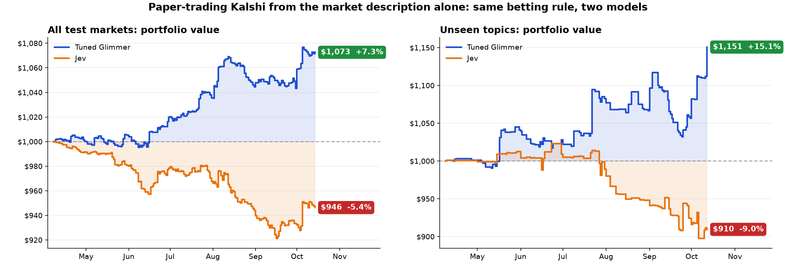

# Kalshi decision-tuning v1

Decision-tune Muse Glimmer on public Kalshi events with `recipes/decision_loop.py`.

- **Profitable:** paper trading turned $1,000 into **$1,151** (+15.1%) on unseen
  topics and **$1,073** (+7.3%) across all test markets.
- **Fast:** the [`systemone` API](#serve-with-the-systemone-decision-api) answers
  **2–3x faster** than standard `/chat/completions` serving on the same B200 GPU.

## What we found



*Paper trading with a fixed +2h entry rule and confidence sizing: portfolio value
from $1,000 as markets settle. Tuned Glimmer ends at **$1,073** on all test
markets (+7.3%) and **$1,151** on unseen topics (+15.1%). Paper only; not
investment advice.*

- **Beats guessing on unseen topics.** Tuned Glimmer gets **58.3%** of questions
  right on topic families never seen in training (always-common baseline 52.9%,
  untuned Glimmer 53.4%, Jev 47.1%).
- **Confidence is usable.** At ≥80% confidence it is right **86.8%** of the time
  on both unseen topics and new events. Before tuning it never reaches that bar.
- **Fast.** **51 ms** median server time per request.


*Red dashed line: always guess the most common answer.*

## Datasets (public Fireworks)

| Split | Resource | Rows | Role |
|---|---|---|---|
| train | `accounts/fireworks/datasets/kalshi-decision-v1-train` | 6,461 | Category-balanced training |
| dev | `accounts/fireworks/datasets/kalshi-decision-v1-dev` | 2,000 | Calibration / fit-T only |
| test | `accounts/fireworks/datasets/kalshi-decision-v1-test` | **8,765** | Full held-out eval |
| unseen_family | `accounts/fireworks/datasets/kalshi-decision-v1-unseen-family` | 765 | Generalization slice (also inside `test`) |

`test` is `original test (2,000) + test_extra (6,000) + unseen_family (765)` in
that order — the “new events” pool from the study plus the held-out families.
`unseen_family` is also published alone for slice reports.

`prepare_data.py` downloads each file via the Fireworks SDK and checks sha256 /
row count against the pins in `SPLITS` before replacing any local copy.

### Dataset breakdown


| Set | What it tests |
|---|---|
| Training | Settled before Jan 2026, category-balanced (Sports capped at 18.6%) |
| Calibration (dev) | Opened 2026-01-11+, settled before 2026-04-01; natural mix (~90% Sports); fit-T only |
| Unseen topics | 113 topic families held out of every other split |
| New events | Opened from Apr 2026 on (original 2k + 6k expand); ~59% Sports after expand |

- **Time gaps:** 7 days between train→dev and dev→test. Dev/test open after
  Glimmer’s stated knowledge cutoff (2026-01-04).
- **Row contract:** one Kalshi *event* → one decision row
  (`state` + `questions`). Mutually exclusive events become one `choice`
  question; everything else becomes up to 8 `noul` (yes/no) questions.
- **No prices / news in the prompt.** Open-time title, rules, and date only.
- **Cross-check:** public Kalshi API settlements match HF
  `TrevorJS/kalshi-trades` (0 mismatches over 337k contracts). Seed `20261012`.

### Category mix (share of markets)


*Training caps Sports at 18.6%; calibration and new events keep Kalshi’s natural
Sports-heavy mix; unseen topics are deliberately spread across categories.
Regenerate with `python media/make_split_charts.py`.*

## Training setup

| Knob | Value |
|---|---|
| Base model | `accounts/fireworks/models/muse-glimmer-30b` |
| Renderer | `muse_glimmer` |
| Recipe | `training.recipes.decision_loop` |
| LoRA | rank 64 / α 32 |
| Optim | Adam lr `1e-4` constant, batch 64, 1 epoch, seed 0 |
| Loss | K-way CE over option-letter tokens (`target_logprob_support="candidates"`) |
| Calibration | Per question-type temperature fitted on **dev**, stamped into `decision.json` |
| Promoted checkpoint | `step-N-cal` |

## Quick start

Author this example only under Fireworks staging
(`public-repos/cookbook/`). Promotion publishes it to the public cookbook later —
do not open a PR against `fw-ai/cookbook` directly.

```bash
cd public-repos/cookbook/training   # Fireworks staging tree
python3 -m venv .venv && source .venv/bin/activate   # Python 3.11+
pip install -e '../../python-sdk[training]' -e '.[dev]'
export FIREWORKS_API_KEY=fw_...     # never paste into chat

python -m examples.decision.kalshi_v1.prepare_data --splits train,dev
python -m examples.decision.kalshi_v1.train_kalshi_decision \
  --output-model-id kalshi-decision-v1-glimmer
```

Smoke (cheaper): `--max-examples 32 --batch-size 8` still runs fit-T and writes
`step-N-cal`. Verified 2026-10-17 on the serverless pool
(`run-f3cc2bf883ea4be2a0b875cbd0b727e6`): eval NLL 1.86→0.72, calibrated
`T_choice≈1.26` / `T_noul≈0.71`.

For offline eval on the full 8,765-row test set and the 765-row unseen slice:

```bash
python -m examples.decision.kalshi_v1.prepare_data --splits test,unseen_family
```

### Managed SFT (once `tuningMode=DECISION` is public)

```bash
firectl supervised-fine-tuning-job create \
  --base-model accounts/fireworks/models/muse-glimmer-30b \
  --dataset accounts/fireworks/datasets/kalshi-decision-v1-train \
  --evaluation-dataset accounts/fireworks/datasets/kalshi-decision-v1-dev \
  --output-model kalshi-decision-v1-glimmer \
  --tuning-mode decision
```

Until that flag ships, the Training API path above is the supported repro.

## Serve with the `systemone` decision API

Query the tuned model with `POST /inference/v1/systemone` instead of
`/chat/completions`. Send one `state` and all of its questions in a single
request. The gateway reads each answer from the option-letter logits, so it
decodes no tokens and there is no text to parse. On one B200 GPU, its median
server time is **2–3x lower** than the standard Glimmer chat deployment.

```bash
curl https://api.fireworks.ai/inference/v1/systemone \
  -H "Authorization: Bearer $FIREWORKS_API_KEY" \
  -H "Content-Type: application/json" \
  -d '{
    "model": "accounts/<your-account>/models/kalshi-decision-v1-glimmer",
    "state": "<event title, rules and open date, as in the dataset rows>",
    "questions": {
      "yes_market": {"type": "noul", "instructions": "Will this market resolve Yes?"},
      "winner": {"type": "choice", "instructions": "Which outcome will happen?",
                 "criteria": {"a": "<outcome A>", "b": "<outcome B>"}}
    }
  }'
```

The response holds `answers` keyed by question ID, with the probability of Yes
for `noul` questions and per-option `probabilities` for `choice` and `score`
questions. `POST /inference/v1/decisions` is an OpenAI-compatible alias: it
takes `input` and an ordered `questions` list.

## Final results

### Unseen-family accuracy (3,567 questions)

| System | Accuracy | ECE (T=1 → dev T) | Server p50 / p90 |
|---|---|---|---|
| Always the common answer | 52.9% | — | — |
| Glimmer untuned | 53.4% | 0.418 → 0.072 | 50 / 86 ms |
| **Glimmer tuned** | **58.2%** | 0.066 → **0.037** | **51 / 87 ms** |
| Jev | 47.1% | 0.100 → 0.023\* | 128 / 163 ms |
| Jeff | 48.4% | 0.239 → 0.021\* | 20 / 25 ms |

\*Jev/Jeff low ECE after fitting T is mostly flattening yes/no answers to ~0.5,
not skill.

- Chronological test (5,990 questions, pre-expand): tuned Glimmer **69.5%**;
  untuned 57.9%; Jev 43.7%; Jeff 41.2%; always-common 58.5%.
- Multiple-choice on unseen families does **not** improve (24.8% vs 28.8% common).
  Gains are on yes/no.


*Per-request server latency at concurrency 1 (tuned Glimmer ≈ 51 ms p50).*

### Calibration and confidence

When tuned Glimmer says ~75%, it is right about 75% of the time. Across unseen
topics and new events, answers at 70–80% confidence were right ~77% of the time,
and answers at 80–90% were right ~86%.

| Confidence ≥ | Unseen topics: questions → correct | New events: questions → correct |
|---|---|---|
| any | 3,567 → **58.3%** | 30,145 → **65.6%** |
| 60% | 1,745 → 67.5% | 19,607 → 74.0% |
| 70% | 598 → 78.9% | 11,135 → 81.3% |
| **80%** | 219 → **86.8%** | 4,644 → **86.8%** |


*Each bar is how often answers in that confidence band were correct; the black
tick is the model's stated confidence. Unseen topics + new events combined.*


*Read left→right: keep only the most confident answers. Tuned Glimmer's
accuracy climbs; untuned climbs less; Jev stays flat. Most ≥80% calls are
“No” on ladder rungs (correlated within an event).*

### Paper trading detail

Each row starts with its own $1,000. “All test markets” pools unseen topics and
new events under one bankroll.


*Top: same equity curves as the hero figure. Bottom: what $1,000 turned into,
with whiskers for the plausible range from resampling events.*

| Model | Test set | Events bet | Bets | Ended with | Return | Plausible range |
|---|---|---|---|---|---|---|
| **Tuned Glimmer** | Unseen topics | 214 | 500 | **$1,151** | **+15.1%** | −3% to +34% |
| **Tuned Glimmer** | New events | 1,837 | 3,361 | **$1,062** | **+6.2%** | +1% to +12% |
| **Tuned Glimmer** | **All test markets** | 2,051 | 3,861 | **$1,073** | **+7.3%** | +2% to +13% |
| Glimmer before tuning | Unseen topics | 228 | 530 | $854 | −14.6% | −28% to 0% |
| Glimmer before tuning | New events | 2,631 | 5,062 | $942 | −5.8% | −11% to −1% |
| Glimmer before tuning | All test markets | 2,859 | 5,592 | $935 | −6.5% | −11% to −2% |
| Jev | Unseen topics | 204 | 384 | $910 | −9.0% | −25% to +5% |
| Jev | New events | 2,347 | 4,911 | $949 | −5.1% | −11% to +1% |
| Jev | All test markets | 2,551 | 5,295 | $946 | −5.4% | −11% to +1% |

Profit came mainly from mid-priced contracts (~29¢ bought, winning ~44% on
unseen topics). Cheap long shots under 20¢ lost money.

**Caveats:** paper trading only; same-event bets are correlated; price-aware /
residual variants did **not** beat the market as a forecast. Market mid remains
the strongest reliable baseline. Not investment advice.

## Known gaps

- Cookbook currently ignores per-question `weight`, so 8-question ladders dominate
  loss (~54% of training questions).
- One-run baseline (one epoch, one seed); no LR sweep.
- Pick-one markets with many options remain weak.

## Provenance

Pins (dataset IDs, row counts, sha256) live in `prepare_data.py` (`SPLITS`).
Expand fetch clock `2026-10-15T01:04:05Z`. Public resources:

- `accounts/fireworks/datasets/kalshi-decision-v1-train`
- `accounts/fireworks/datasets/kalshi-decision-v1-dev`
- `accounts/fireworks/datasets/kalshi-decision-v1-test`
- `accounts/fireworks/datasets/kalshi-decision-v1-unseen-family`
